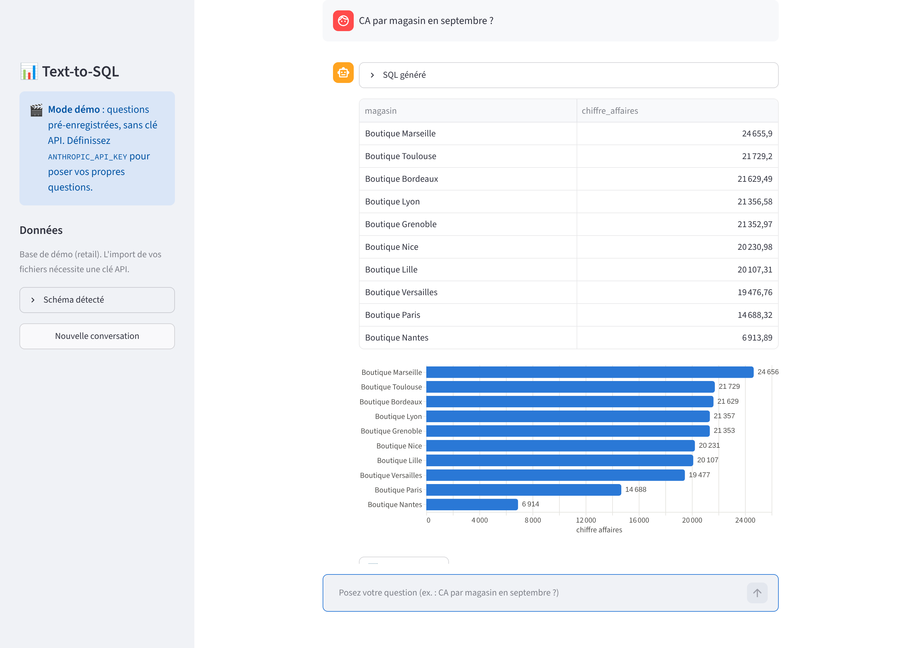
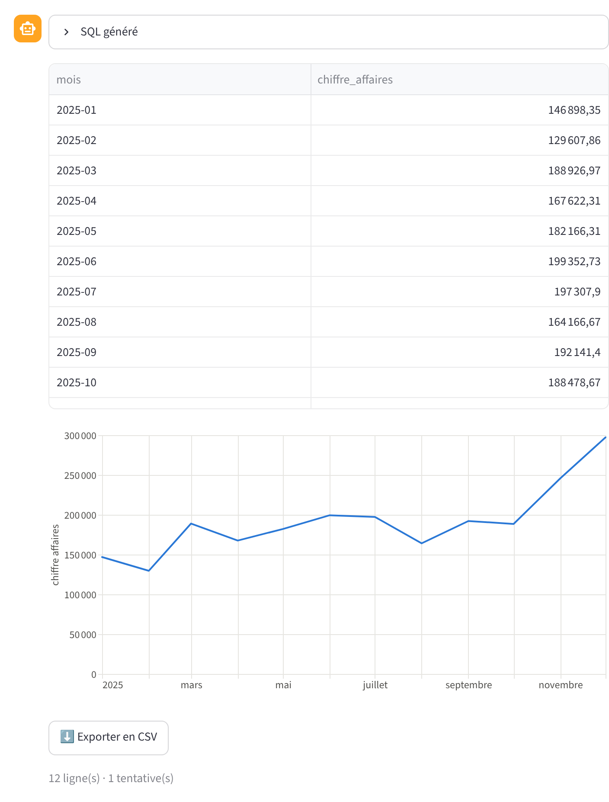
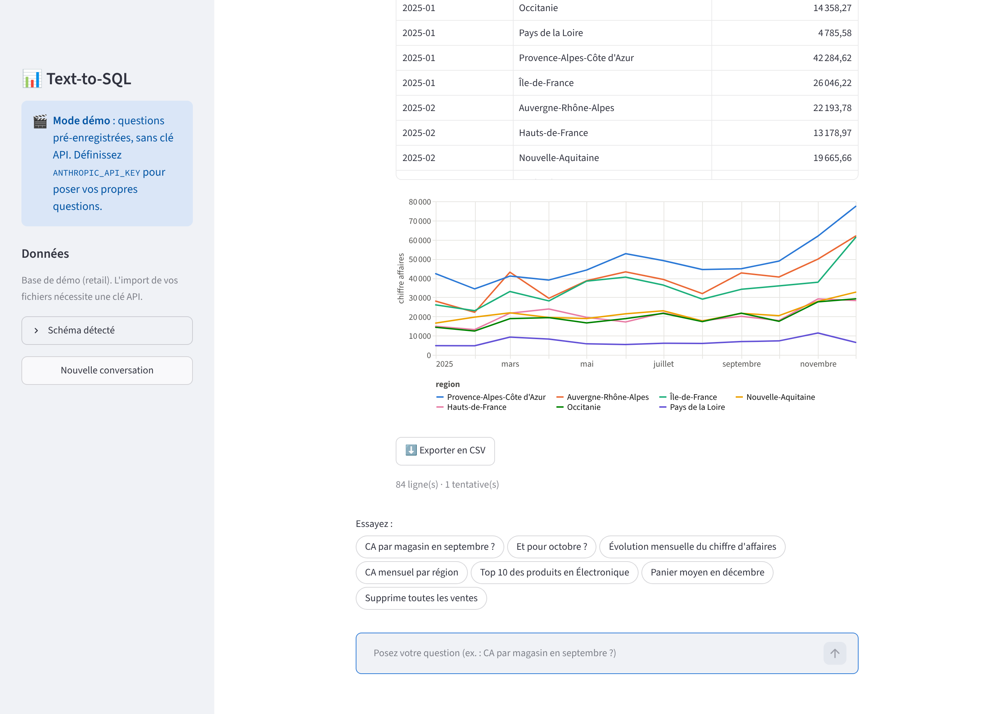
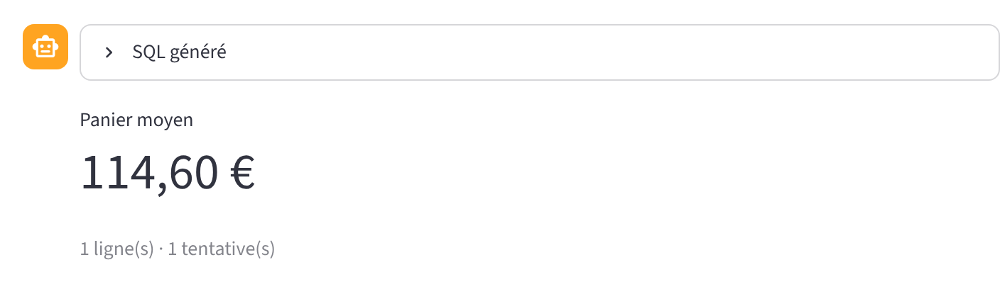
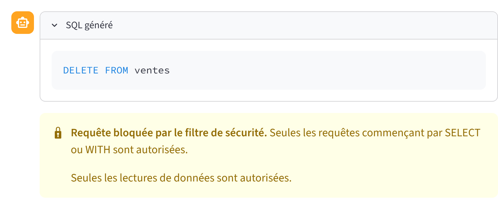

# 📊 Text-to-SQL — interrogez vos données en français

> « CA par magasin en septembre ? » → requête SQL, tableau et graphique en quelques secondes.
> Sans écrire une ligne de SQL, sans risque pour vos données.



Text-to-SQL transforme une question posée en langage naturel en requête SQL grâce à **Claude**
(Anthropic), l'exécute **en lecture seule** sur votre base, puis affiche le résultat sous la forme
la plus lisible : indicateur, barres, courbe ou comparaison de séries. Les questions de suivi
(« et pour octobre ? ») fonctionnent comme dans une vraie conversation.

## Pourquoi c'est utile

| Pour… | Ce que ça change |
|---|---|
| **Directions et managers** | Une réponse chiffrée immédiate, sans attendre l'équipe data |
| **Équipes data** | Moins de demandes ponctuelles, SQL généré visible et vérifiable |
| **DSI / sécurité** | Trois couches de protection, journal d'audit, aucune écriture possible |

## Fonctionnalités

- 💬 **Conversation en français** avec mémoire : les questions de suivi reprennent le contexte.
- 🧠 **Schéma détecté automatiquement** (tables, colonnes, valeurs possibles, périodes couvertes).
- 📂 **Vos propres données** : importez des CSV (séparateur et encodage détectés, dates converties)
  ou une base SQLite, directement depuis l'interface.
- 📈 **Graphique choisi automatiquement** : indicateur pour une valeur unique, barres triées pour un
  classement, courbe pour une évolution, une courbe par série pour une comparaison.
  Palette testée pour le daltonisme, format français des nombres et des dates, mode sombre.
- 🔁 **Auto-correction** : si une requête échoue, l'erreur est renvoyée au modèle (2 essais maximum),
  puis un message clair s'affiche.
- ✍️ **Synthèse en langage naturel** du résultat (désactivable).
- ⬇️ **Export CSV** de chaque résultat.
- 💶 **Coût maîtrisé** : tokens et coût estimé affichés par question et pour la session.
- 🧾 **Journal d'audit** JSON Lines : question, SQL, statut, tentatives, coût.
- 🎬 **Mode démo sans clé API** : idéal pour une présentation ou un premier essai.

| Évolution mensuelle | Comparaison de séries (mode sombre) |
|---|---|
|  |  |

| Indicateur | Requête dangereuse bloquée |
|---|---|
|  |  |

## Sécurité : trois couches indépendantes

1. **Filtre syntaxique** : une seule instruction, commençant par `SELECT` ou `WITH` ; refus de `;`,
   des commentaires et des mots-clés `DROP`, `DELETE`, `UPDATE`, `INSERT`, `ALTER`, `PRAGMA`,
   `CREATE`, `ATTACH`, `REPLACE INTO`… `LIMIT 500` ajouté si absent.
2. **Autorisateur SQLite** : le moteur lui-même refuse toute opération autre que la lecture,
   même si une requête passait le filtre.
3. **Connexion en lecture seule** (`mode=ro`) avec **délai maximal** d'exécution (10 s).

Chaque couche est couverte par des tests automatisés (`tests/test_securite.py`).

## Démarrage rapide

```bash
pip install -r requirements.txt
python seed_db.py
ANTHROPIC_API_KEY="sk-ant-..." streamlit run app.py
```

Ouvrez http://localhost:8501. Sans `ANTHROPIC_API_KEY`, l'application démarre en **mode démo**.

### Avec Docker

```bash
docker build -t text2sql .
docker run -p 8501:8501 -e ANTHROPIC_API_KEY="sk-ant-..." text2sql
```

## Configuration

| Variable | Défaut | Rôle |
|---|---|---|
| `ANTHROPIC_API_KEY` | — | Clé API Claude (absente = mode démo) |
| `TEXT2SQL_MODEL` | `claude-opus-5-5` | Modèle utilisé |
| `TEXT2SQL_EFFORT` | `low` | Profondeur de raisonnement (`low` à `max`) |
| `TEXT2SQL_DB` | `retail.db` | Base de démonstration |
| `TEXT2SQL_JOURNAL` | `logs/requetes.jsonl` | Journal d'audit (vide = désactivé) |

## Mesurer la précision

`evals/` contient 20 questions représentatives (agrégats, jointures, dates, questions de suivi)
avec leur requête de référence. Le script compare les **résultats** obtenus, pas le texte du SQL :

```bash
ANTHROPIC_API_KEY="sk-ant-..." python evals/run_eval.py
```

Il affiche la précision, le nombre de tentatives et le coût total, et enregistre le détail en JSON.

## Architecture

```
app.py                 Interface Streamlit (chat, barre latérale, rendu)
text2sql/
  securite.py          Filtre SQL, autorisateur, connexion lecture seule + délai
  base.py              Lecture du schéma, exécution, import CSV / SQLite
  llm.py               Prompt (schéma + few-shot), appel Claude, boucle de correction, synthèse
  graphiques.py        Choix et construction des graphiques (Altair)
  demo.py              Questions pré-enregistrées du mode démo
  journal.py           Journal d'audit JSON Lines
  config.py            Paramètres (surchargeables par variables d'environnement)
seed_db.py             Base retail de démonstration (Faker)
evals/                 Banc d'essai de précision
tests/                 Tests pytest (sécurité, pipeline, graphiques)
```

## Développement

```bash
pip install -r requirements-dev.txt
python -m pytest -q     # tests
ruff check .            # lint
```

L'intégration continue (GitHub Actions) exécute le lint et les tests sur Python 3.10, 3.12 et 3.13.
