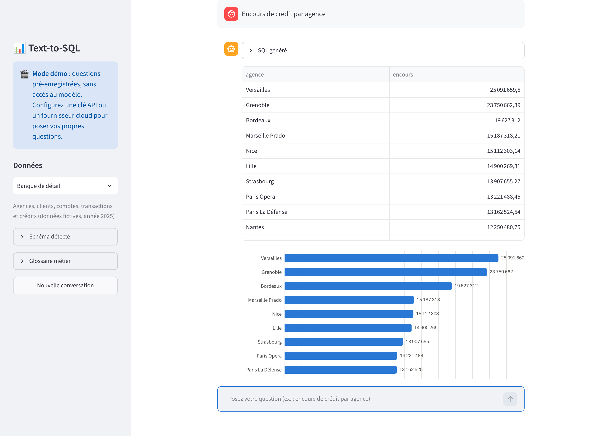
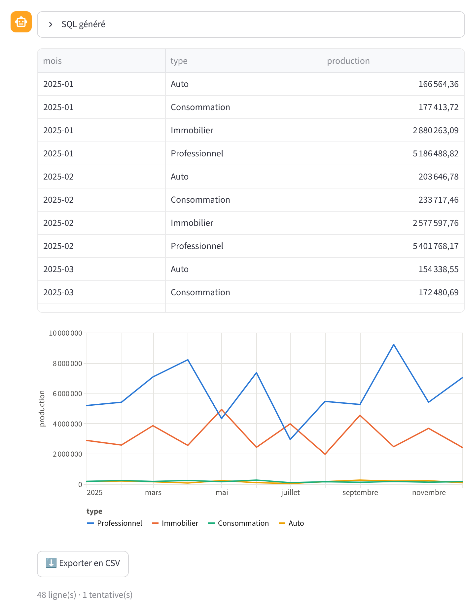
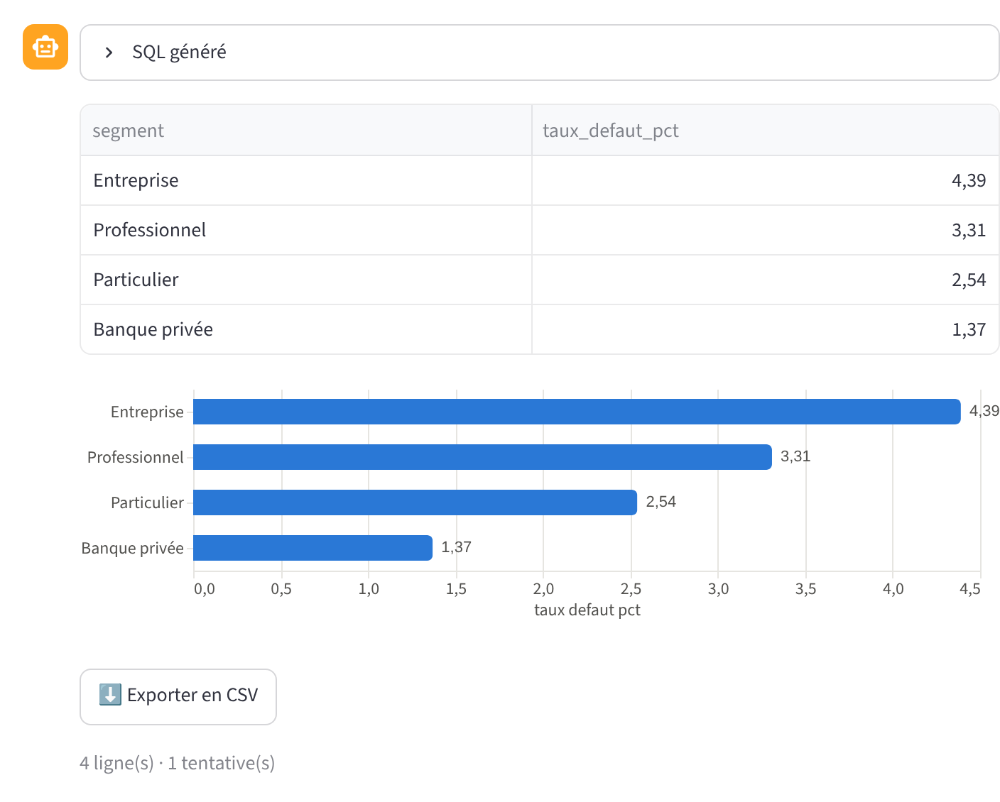
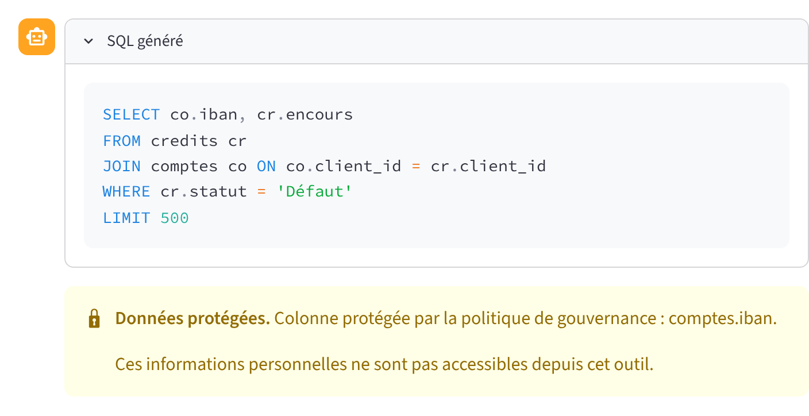
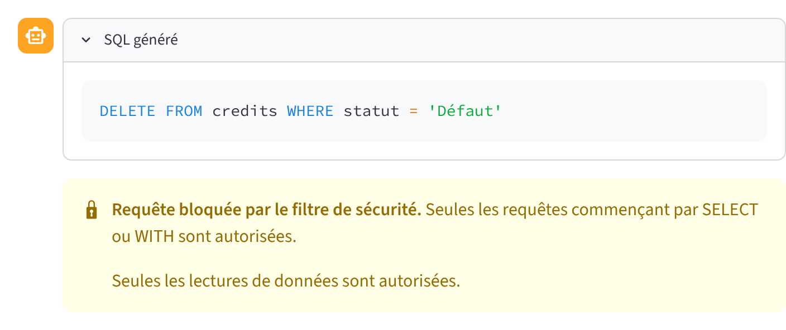

# 📊 Text-to-SQL — interrogez vos données en français

> « Encours de crédit par agence ? » → requête SQL, tableau et graphique en quelques secondes.
> Sans écrire une ligne de SQL, sans exposer les données personnelles.



Text-to-SQL transforme une question posée en langage naturel en requête SQL grâce à **Claude**
(Anthropic), l'exécute **en lecture seule** sur votre base, puis affiche le résultat sous la forme
la plus lisible : indicateur, barres, courbe ou comparaison de séries. Les questions de suivi
(« et seulement pour l'immobilier ? ») fonctionnent comme dans une vraie conversation.

Conçu pour les **business analysts** d'environnements régulés : glossaire métier maison,
colonnes protégées bloquées par le moteur SQL, modèle hébergé dans votre cloud (AWS Bedrock ou
Google Vertex AI), authentification SSO et journal d'audit nominatif.

## Pourquoi c'est utile

| Pour… | Ce que ça change |
|---|---|
| **Business analysts** | Une réponse chiffrée en autonomie, avec le SQL visible pour vérifier |
| **Équipes data** | Moins de demandes ponctuelles ; définitions métier centralisées dans un glossaire |
| **RSSI / conformité** | Lecture seule, données personnelles bloquées, trace de chaque question par utilisateur |

## Fonctionnalités

- 💬 **Conversation en français** avec mémoire : les questions de suivi reprennent le contexte.
- 📚 **Profils métier** (`profils/*.toml`) : glossaire (« encours », « collecte nette », « NPL »…),
  exemples de requêtes, questions de démo et gouvernance, modifiables sans toucher au code.
- 🔐 **Colonnes protégées** : nom, date de naissance, IBAN… jamais décrits au modèle, et toute
  requête qui les lit est refusée par le moteur SQL lui-même.
- 🧠 **Schéma détecté automatiquement** (tables, colonnes, valeurs possibles, périodes couvertes).
- 📂 **Vos propres données** : CSV (séparateur, encodage et dates détectés) ou base SQLite.
- 📈 **Graphique choisi automatiquement** : indicateur (€ ou %), barres triées, courbe, une courbe
  par série. Palette testée pour le daltonisme, format français, mode sombre.
- 🔁 **Auto-correction** : une requête en échec est renvoyée au modèle (2 essais maximum).
- ✍️ **Synthèse en langage naturel** du résultat (désactivable, ou interdite par configuration).
- ⬇️ **Export CSV**, 💶 **coût affiché** par question, 🧾 **journal d'audit** JSON Lines.
- 🎬 **Mode démo sans accès au modèle** : idéal pour une présentation.

| Production de crédits par type | Taux de défaut par segment |
|---|---|
|  |  |

| Données personnelles protégées | Écriture bloquée |
|---|---|
|  |  |

## Sécurité : trois couches indépendantes

1. **Filtre syntaxique** : une seule instruction, commençant par `SELECT` ou `WITH` ; refus de `;`,
   des commentaires et des mots-clés `DROP`, `DELETE`, `UPDATE`, `INSERT`, `ALTER`, `PRAGMA`,
   `CREATE`, `ATTACH`, `REPLACE INTO`… `LIMIT 500` ajouté si absent.
2. **Autorisateur SQLite** : le moteur refuse toute opération autre que la lecture, ainsi que toute
   lecture d'une colonne protégée, même indirecte (`SELECT *`, fonction, sous-requête).
3. **Connexion en lecture seule** (`mode=ro`) avec **délai maximal** d'exécution (10 s).

Chaque couche est couverte par des tests automatisés (`tests/`).

## Confidentialité : ce qui part vers le modèle

| Envoyé au modèle | Jamais envoyé |
|---|---|
| La question | Le contenu des tables |
| Le schéma (noms de tables et de colonnes, hors colonnes protégées) | Les colonnes protégées |
| Quelques valeurs de référence (désactivable : `TEXT2SQL_VALEURS_EXEMPLES=0`) | |
| Les 50 premières lignes du résultat pour la synthèse (désactivable : `TEXT2SQL_SYNTHESE=0`) | |

Avec les deux options désactivées, **aucune donnée de la base** ne quitte votre périmètre :
seuls la question et les noms de colonnes sont transmis.

## Démarrage rapide

```bash
pip install -r requirements.txt
python seed_banque.py && python seed_db.py
ANTHROPIC_API_KEY="sk-ant-..." streamlit run app.py
```

Ouvrez http://localhost:8501. Sans accès au modèle, l'application démarre en **mode démo**.

### Modèle hébergé dans votre cloud

```bash
# AWS Bedrock (identifiants AWS standards : rôle IAM, profil ou variables)
TEXT2SQL_FOURNISSEUR=bedrock TEXT2SQL_REGION=eu-west-3 streamlit run app.py

# Google Vertex AI (pip install "anthropic[vertex]", identifiants gcloud)
TEXT2SQL_FOURNISSEUR=vertex TEXT2SQL_REGION=europe-west1 TEXT2SQL_PROJET_GCP=mon-projet streamlit run app.py
```

Vérifiez la disponibilité du modèle choisi dans la région visée.

### Authentification SSO

Copiez `.streamlit/secrets.toml.example` en `.streamlit/secrets.toml`, renseignez votre fournisseur
OpenID Connect (Entra ID, Okta, Keycloak…) et installez `Authlib`. La connexion devient obligatoire
et l'identité de l'utilisateur est inscrite dans le journal d'audit.

### Avec Docker

```bash
docker build -t text2sql .
docker run -p 8501:8501 -e ANTHROPIC_API_KEY="sk-ant-..." text2sql
```

## Configuration

| Variable | Défaut | Rôle |
|---|---|---|
| `ANTHROPIC_API_KEY` | — | Clé API Claude (fournisseur `anthropic`) |
| `TEXT2SQL_FOURNISSEUR` | `anthropic` | `anthropic`, `bedrock` ou `vertex` |
| `TEXT2SQL_REGION` | — | Région cloud (Bedrock, Vertex) |
| `TEXT2SQL_PROJET_GCP` | — | Projet Google Cloud (Vertex) |
| `TEXT2SQL_INFERENCE_GEO` | — | Zone d'inférence imposée (API Claude) |
| `TEXT2SQL_MODEL` | `claude-opus-5-5` | Modèle utilisé |
| `TEXT2SQL_EFFORT` | `low` | Profondeur de raisonnement (`low` à `max`) |
| `TEXT2SQL_PROFIL` | `banque` | Profil métier affiché au démarrage |
| `TEXT2SQL_PROFILS` | `profils/` | Dossier des profils métier |
| `TEXT2SQL_VALEURS_EXEMPLES` | `1` | Envoyer des valeurs de référence avec le schéma |
| `TEXT2SQL_SYNTHESE` | `1` | Autoriser la synthèse (envoi d'un extrait du résultat) |
| `TEXT2SQL_JOURNAL` | `logs/requetes.jsonl` | Journal d'audit (vide = désactivé) |

## Ajouter un profil métier

Créez `profils/<nom>.toml` (voir `profils/banque.toml`) : `nom`, `base` (fichier SQLite),
`[glossaire]`, `[gouvernance] colonnes_protegees = ["table.colonne", …]`, au moins quatre
`[[exemples]]` (question + SQL) et des `[[demo]]` pour le mode démo.

## Mesurer la précision

`evals/` contient 20 questions représentatives avec leur requête de référence. Le script compare
les **résultats** obtenus, pas le texte du SQL :

```bash
ANTHROPIC_API_KEY="sk-ant-..." python evals/run_eval.py
```

## Architecture

```
app.py                 Interface Streamlit (chat, barre latérale, SSO, rendu)
profils/               Profils métier TOML (glossaire, exemples, démo, gouvernance)
text2sql/
  securite.py          Filtre SQL, autorisateur (lecture seule + colonnes protégées), délai
  base.py              Lecture du schéma, exécution, import CSV / SQLite
  llm.py               Prompt, client (API Claude, Bedrock, Vertex), correction, synthèse
  profils.py           Chargement et validation des profils
  graphiques.py        Choix et construction des graphiques (Altair)
  demo.py              Mode démo
  journal.py           Journal d'audit JSON Lines (utilisateur, source, SQL, coût)
  config.py            Paramètres (variables d'environnement)
seed_banque.py         Base bancaire fictive (agences, clients, comptes, transactions, crédits)
seed_db.py             Base retail fictive
evals/                 Banc d'essai de précision
tests/                 Tests pytest
```

## Développement

```bash
pip install -r requirements-dev.txt
python -m pytest -q     # tests
ruff check .            # lint
```

L'intégration continue (GitHub Actions) exécute le lint et les tests sur Python 3.11, 3.12 et 3.13.
Toutes les données de démonstration sont fictives.
