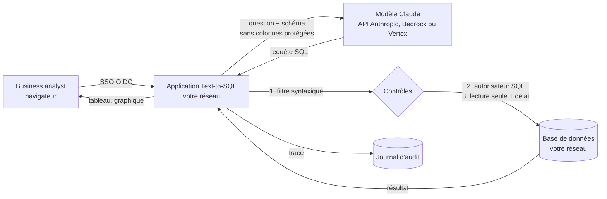

# Dossier sécurité et conformité — Text-to-SQL

*À l'attention des équipes RSSI, conformité, protection des données et achats.*
*Version du document : octobre 2026. Ce dossier décrit le produit tel qu'il est livré ; les points
réglementaires sont des éléments de réponse, à valider par vos fonctions juridique et conformité.*

---

## 1. Résumé

Text-to-SQL permet à un business analyst de poser une question en français sur une base de données
et d'obtenir le résultat sous forme de tableau et de graphique. Un modèle de langage (Claude,
d'Anthropic) **rédige** la requête SQL ; l'application la **contrôle** puis l'**exécute en lecture
seule** dans votre infrastructure.

| Question | Réponse courte |
|---|---|
| Le modèle peut-il modifier les données ? | Non. Trois contrôles indépendants imposent la lecture seule. |
| Le modèle voit-il les données clients ? | Non par défaut pour le contenu des tables ; jamais pour les colonnes protégées. Voir § 3. |
| Où tourne l'application ? | Chez vous : poste, serveur ou conteneur dans votre réseau. |
| Où tourne le modèle ? | Au choix : API Anthropic, ou AWS Bedrock / Google Vertex AI dans votre compte cloud et la région choisie. |
| Qui a posé quelle question ? | Journal d'audit nominatif (avec SSO) : question, SQL, statut, coût. |
| Le SQL est-il vérifiable ? | Oui, il est affiché à chaque réponse. |

## 2. Architecture et flux de données

1. L'utilisateur s'authentifie (SSO OpenID Connect, optionnel) et pose sa question.
2. L'application envoie au modèle la question et la description du schéma.
3. Le modèle renvoie une requête SQL, qui passe les contrôles du § 4 avant toute exécution.
4. La requête s'exécute sur une connexion en lecture seule ; le résultat reste dans l'application.
5. Optionnellement, un extrait du résultat est envoyé au modèle pour rédiger une synthèse.
6. Chaque question est tracée dans le journal d'audit.

## 3. Données transmises au modèle

| Élément | Transmis ? | Paramètre |
|---|---|---|
| Question de l'utilisateur | Oui | — |
| Noms des tables et des colonnes | Oui, **hors colonnes protégées** | `profils/*.toml`, section `[gouvernance]` |
| Glossaire métier et exemples de requêtes | Oui | `profils/*.toml` |
| Valeurs de référence (listes de catégories, plages de dates) | Oui par défaut | `TEXT2SQL_VALEURS_EXEMPLES=0` pour désactiver |
| Extrait du résultat (50 lignes au plus) pour la synthèse | Oui par défaut | `TEXT2SQL_SYNTHESE=0` pour interdire |
| Contenu des tables | **Non** | — |
| Colonnes protégées (nom, date de naissance, IBAN…) | **Jamais** | — |
| Identité de l'utilisateur | **Non** | conservée dans le journal local uniquement |

**Configuration recommandée pour une banque** : `TEXT2SQL_VALEURS_EXEMPLES=0` et
`TEXT2SQL_SYNTHESE=0`. Le modèle ne reçoit alors que la question, les noms de colonnes non
protégées, le glossaire et les exemples de requêtes : aucune donnée issue de la base.

L'interface affiche en permanence ce qui est transmis (panneau « Confidentialité »).

## 4. Contrôles de sécurité

| Couche | Mécanisme | Ce qu'elle bloque |
|---|---|---|
| 1. Filtre syntaxique | Une seule instruction, commençant par `SELECT` ou `WITH` ; refus de `;`, des commentaires et des mots-clés d'écriture ou d'administration (`DROP`, `DELETE`, `UPDATE`, `INSERT`, `ALTER`, `CREATE`, `PRAGMA`, `ATTACH`, `REPLACE INTO`…) ; `LIMIT 500` imposé | Injection d'instructions, requêtes multiples, extraction massive |
| 2. Autorisateur du moteur SQL | Callback d'autorisation du moteur : seules les opérations de lecture sont permises, et la lecture d'une colonne protégée est refusée | Écriture même si la couche 1 était contournée ; accès aux données personnelles, y compris via `SELECT *`, une fonction ou une sous-requête |
| 3. Connexion | Base ouverte en lecture seule (`mode=ro`) ; requête interrompue au-delà de 10 secondes | Toute écriture ; requêtes qui monopoliseraient la base |

Ces contrôles sont couverts par une suite de tests automatisés (95 tests, exécutés à chaque
modification par l'intégration continue). Une revue de sécurité du code a été menée à chaque
évolution majeure ; les défauts relevés ont été corrigés.

**Propositions de durcissement côté banque** : exécuter l'application avec un compte de base de
données disposant uniquement de droits de lecture sur un schéma ou une vue dédiés ; placer
l'application derrière votre reverse proxy et votre WAF ; restreindre les flux sortants au seul
point d'accès du modèle.

## 5. Gestion des accès et traçabilité

- **Authentification** : SSO OpenID Connect (Microsoft Entra ID, Okta, Keycloak, Google…),
  configuré dans `.streamlit/secrets.toml`. Lorsqu'il est activé, aucune page n'est accessible
  sans connexion.
- **Journal d'audit** (`logs/requetes.jsonl`, une ligne JSON par question) :
  horodatage UTC, utilisateur, source de données, mode, modèle, question, SQL exécuté, succès ou
  blocage, message d'erreur, nombre de tentatives, nombre de lignes renvoyées, tokens et coût.
  **Les données renvoyées ne sont pas journalisées.**
- Le journal peut être collecté par votre SIEM (format JSON Lines).

## 6. Hébergement et déploiement

| Composant | Options |
|---|---|
| Application | Conteneur Docker (utilisateur non privilégié) ou installation Python 3.11+, dans votre réseau |
| Modèle | API Anthropic ; **AWS Bedrock** ou **Google Vertex AI** dans votre compte cloud et la région de votre choix (`TEXT2SQL_FOURNISSEUR`, `TEXT2SQL_REGION`) |
| Données | SQLite et fichiers CSV aujourd'hui ; connecteurs entrepôt de données : voir § 9 |

Avec Bedrock ou Vertex, les appels au modèle passent par votre contrat et votre compte cloud, dans
la région que vous choisissez. Les engagements du fournisseur cloud sur la localisation et la
non-réutilisation des données sont à vérifier dans vos conditions contractuelles. La
disponibilité du modèle dans une région donnée est à vérifier auprès du fournisseur.

## 7. Éléments de réponse réglementaires

*À valider par vos fonctions juridique, conformité et DPO.*

### RGPD

- **Minimisation** : colonnes de données personnelles protégées, jamais transmises ; options pour
  ne transmettre aucune donnée de la base (§ 3).
- **Sous-traitance** : le fournisseur du modèle (Anthropic, AWS ou Google selon l'option) agit en
  sous-traitant ; le contrat de traitement correspondant est à mettre en place par la banque.
- **Transferts hors UE** : à évaluer selon le fournisseur et la région retenus ; l'option cloud en
  région européenne est prévue pour y répondre.
- **Sécurité du traitement** : contrôles du § 4, authentification, journal d'audit.

### DORA (règlement (UE) 2022/2554)

- L'éditeur et le fournisseur du modèle sont des prestataires tiers de services TIC à inscrire au
  registre d'informations de la banque.
- Éléments disponibles pour l'évaluation : architecture, flux de données, contrôles, journal,
  tests automatisés, code source consultable.
- Réversibilité : l'application ne stocke aucune donnée métier en propre ; les profils
  métier sont des fichiers texte ; l'arrêt de l'outil n'a pas d'effet sur les bases interrogées.

### Règlement européen sur l'IA (règlement (UE) 2024/1689)

- L'outil assiste l'analyse de données agrégées ; il **ne prend pas de décision** sur des
  personnes et ne réalise pas d'évaluation de solvabilité. La classification du cas d'usage reste
  à confirmer par la banque, notamment si l'outil était utilisé dans un processus d'octroi de
  crédit.
- **Transparence et contrôle humain** : le SQL généré est affiché à chaque réponse ; l'utilisateur
  voit sur quoi repose le résultat.
- **Maîtrise de l'IA** : un banc d'essai (`evals/`) mesure la précision sur des questions de
  référence ; il peut être enrichi avec les questions de la banque.

### Orientations EBA sur l'externalisation et gouvernance des données

- Les profils métier formalisent les définitions des indicateurs (glossaire), ce qui contribue à la
  cohérence des chiffres produits.
- La traçabilité question → SQL → résultat est assurée par le journal d'audit.

## 8. Répartition des responsabilités

| Sujet | Éditeur | Banque |
|---|---|---|
| Contrôles applicatifs (§ 4), tests, correctifs | ✔ | |
| Configuration des colonnes protégées et du glossaire | Accompagnement | ✔ |
| Comptes de base de données en lecture seule, vues dédiées | Recommandations | ✔ |
| Hébergement, réseau, sauvegarde des journaux | | ✔ |
| Contrat avec le fournisseur du modèle (Anthropic, AWS, Google) | | ✔ |
| SSO, gestion des habilitations | Intégration | ✔ |
| Analyse d'impact, registre DORA, classification IA | Éléments fournis | ✔ |

## 9. Limites actuelles et feuille de route

Nous préférons les énoncer clairement :

- **Sources de données** : SQLite et CSV aujourd'hui. Les connecteurs vers vos entrepôts
  (PostgreSQL, Oracle, SQL Server, Snowflake…) sont à réaliser lors du pilote ; la lecture seule y
  reposera sur un compte à droits restreints en plus des contrôles applicatifs.
- **Habilitations fines** : les colonnes protégées s'appliquent à tous les utilisateurs d'un
  profil ; des droits par rôle (par table ou par périmètre d'agences) sont à développer.
- **Fiabilité du modèle** : une requête peut être syntaxiquement correcte mais ne pas répondre
  exactement à la question. Le SQL affiché, le glossaire et le banc d'essai réduisent ce risque ;
  ils ne le suppriment pas. Les chiffres destinés à un usage réglementaire doivent être validés.
- **Journal** : fichier local non chiffré ; à collecter dans votre SIEM ou un stockage protégé.
- **Certifications** : l'éditeur ne détient pas, à ce jour, de certification ISO 27001 ou SOC 2.

## 10. Questionnaire type

| Question fréquente | Réponse |
|---|---|
| Le produit peut-il écrire, modifier ou supprimer des données ? | Non : filtre syntaxique, autorisateur du moteur et connexion en lecture seule (§ 4). |
| Les données clients sont-elles envoyées au modèle ? | Les colonnes protégées jamais ; le contenu des tables non. Un extrait du résultat peut l'être pour la synthèse, désactivable (§ 3). |
| Les données servent-elles à entraîner le modèle ? | Selon les conditions du fournisseur retenu, à vérifier contractuellement. |
| Où sont hébergés l'application et le modèle ? | Application chez vous ; modèle via l'API Anthropic ou votre compte AWS / Google Cloud, région au choix (§ 6). |
| Comment les utilisateurs sont-ils authentifiés ? | SSO OpenID Connect (§ 5). |
| Les actions sont-elles tracées ? | Oui, une ligne par question, avec l'utilisateur et le SQL exécuté (§ 5). |
| Peut-on limiter les colonnes accessibles ? | Oui, par configuration (`colonnes_protegees`), appliquée par le moteur SQL. |
| Que se passe-t-il si le modèle génère une requête dangereuse ? | Elle est bloquée et un message explique pourquoi ; l'événement est journalisé. |
| Peut-on vérifier une réponse ? | Le SQL est affiché ; le résultat est exportable en CSV. |
| Le code source est-il auditable ? | Oui, il peut être remis pour audit. |
| Quelle est la dépendance au fournisseur du modèle ? | Trois fournisseurs possibles par configuration ; aucune donnée métier stockée par l'outil. |
| Comment mesurer la qualité des réponses ? | Banc d'essai fourni, à enrichir avec vos questions de référence (§ 7). |
